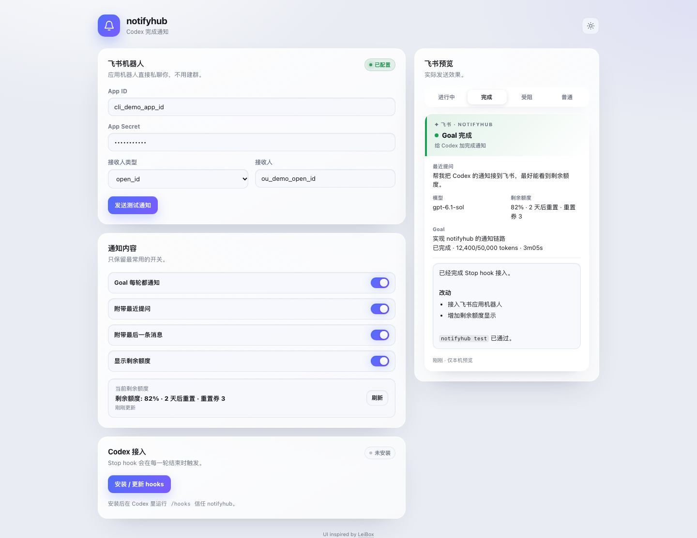

<div align="center">

# notifyhub

**任务完成，飞书知道。离开电脑，接着聊。**

Codex · DeepSeek Harness · Claude Code · Command Code


[快速开始](#quick-start) · [配置飞书](references/feishu-setup.md) · [手机续聊](#native-bridge) · [常见问题](#faq)

</div>

notifyhub 把本地 agent 的完成结果发到你的飞书私聊，带上会话名、最近提问和回答。在实验性的 dsh 原生续聊模式下，你还可以从手机选择电脑上的对话，接着发消息，结果写回原会话。

| 我想做什么 | 选择 | 运行方式 |
|---|---|---|
| agent 跑完后收到提醒 | **完成通知** | 安装对应 hook 或 dsh 通知插件 |
| 用飞书继续电脑上的 dsh 对话 | **原生续聊 · 实验性** | dsh 桌面插件＋飞书长连接 |

> **安装路线**：`main` 同时包含完成通知与实验性原生续聊。两者独立配置；只需要完成通知时，完成快速开始即可。

## 一眼看懂

- **完成通知**：状态、会话标题、最近提问、最终回答；Codex 还可显示剩余额度和 Goal 信息。
- **本地配置界面**：填写飞书凭据、查找接收人、测试发送、安装通知集成。
- **原生续聊**：查看历史主会话，点按钮切换，沿用原会话上下文、模型和工作目录。
- **手机卡片**：项目、模型和运行状态一目了然；回答保留 Markdown，附轮次和耗时。

<details>
<summary>查看本地配置界面</summary>



</details>

<a id="quick-start"></a>
## 快速开始：先收到第一条通知

### 1. 准备环境

准备 Python **3.10+** 和你要接入的 agent；飞书应用可以在打开 GUI 后按下一步创建。项目主要在 macOS 使用；原生续聊建议使用 Python **3.12**。

```bash
git clone https://github.com/oldtommmy/notifyhub.git
cd notifyhub
python3 --version
```

下文的命令均在仓库根目录执行。如果系统的 `python3` 太旧，请换成已安装的 `python3.12`。

### 2. 先打开本地 GUI

```bash
python3 scripts/notifyhub.py gui
```

命令会启动本地配置服务并打开浏览器。没有自动打开时，使用终端打印的完整地址（含访问令牌）。配置期间保持该终端运行，按 `Ctrl+C` 退出。

先打开页面即可，尚未创建飞书应用时不必填写凭据。GUI 用于配置和测试完成通知；续聊的飞书长连接由 dsh 原生插件启动，打开 GUI 本身不会建立长连接。

### 3. 创建飞书机器人，回到 GUI 填写凭据

到 [飞书开发者后台](https://open.feishu.cn/app) 创建企业自建应用，开启机器人能力。在权限管理中一次导入 **[bot-config.json 完整权限预设](bot-config.json)**，按后台要求申请权限、配置应用可用范围并发布。

默认按完整 JSON 导入即可，无需逐个搜索权限。精简权限文件留给需要自行控制授权范围的用户。

完整步骤见 **[飞书机器人配置教程](references/feishu-setup.md)**。应用配置完成后，回到已打开的 GUI：

1. 填写应用的 **App ID** 和 **App Secret**。
2. 点击 **自动获取**，优先选择应用所有者的 `open_id`；也可以手动填写已核实的接收人。
3. 保存配置，点击测试发送，确认飞书私聊收到卡片。

配置默认保存在 `~/.config/notifyhub/config.json`。App Secret 在本机界面或环境变量中填写，无需发给聊天里的 agent。

<details>
<summary>使用命令行配置</summary>

先在本机设置环境变量 `NOTIFYHUB_FEISHU_APP_SECRET`，再执行：

```bash
# 查找应用所有者的 open_id；此步骤不发送消息
python3 scripts/feishu_probe.py --app-id cli_xxxxxxxx --owner

# App Secret 自动从环境变量读取；配置写入前会备份旧文件
python3 scripts/setup_config.py \
  --app-id cli_xxxxxxxx \
  --receive-id ou_xxxxxxxx \
  --receive-id-type open_id

python3 scripts/notifyhub.py test --channel feishu_app
```

自动查找失败时，按[教程](references/feishu-setup.md#receiver)核对接收人和应用信息权限。

</details>

### 4. 接入你使用的 agent

只安装对应的集成：

| Agent | 安装命令 | 安装之后 |
|---|---|---|
| Codex | `python3 scripts/notifyhub.py install-hooks` | 在 `/hooks` 或桌面 Settings → Hooks 中信任 hook |
| Claude Code | `python3 scripts/notifyhub.py install-hooks --target claude` | 重启宿主并检查 hook |
| Command Code | `python3 scripts/notifyhub.py install-hooks --target commandcode` | 重启宿主并检查 hook |
| DSH Desktop | `python3 scripts/notifyhub.py install-dsh --profile desktop` | 重启 dsh App |
| dsh web | `python3 scripts/notifyhub.py install-dsh --profile web` | 重启 `dsh web` |

```bash
python3 scripts/notifyhub.py doctor
```

让对应 agent 完成一轮任务，确认飞书收到真实任务的完成通知。DSH 的 `desktop` 和 `web` 是不同 profile，需要分别安装。

<details>
<summary>检测不到 dsh CLI？先处理安装，再安装通知插件</summary>

先检查 `command -v dsh` 和 `dsh --version`。macOS 已安装桌面 App 时，也检查其自带 CLI：

```bash
"/Applications/DeepSeek Harness.app/Contents/Resources/runtime/cli/bin/dsh" --version
```

若该命令可用，可在当前终端把对应 `bin` 目录加入 PATH 后继续安装插件，保留桌面版的 CLI 版本。确实未安装时，检查 Node.js/npm 后安装：

```bash
node --version
npm --version
npm view @deepseek-ai/dsh engines --json
npm install -g @deepseek-ai/dsh
dsh --version
```

Node.js 不存在时，先从 [Node.js 官方下载页](https://nodejs.org/en/download)安装满足 dsh 要求的版本。安装后若 PATH 尚未更新，重新打开终端再验证；不便全局安装时可用 `npx @deepseek-ai/dsh --version` 验证 npm 启动方式。完整处理流程见 [DSH 安装排障](references/dsh.md#missing-cli)。

</details>

### 在 GUI 安装通知＋dsh 续聊

在 **DeepSeek Harness** 卡片中选择“桌面版”，将安装功能切换为 **完成通知＋dsh 续聊**：

1. 先保存上方的飞书凭据，并按教程导入完整 `bot-config.json`。
2. 填写允许使用者的 `open_id`（多个用逗号分隔）。
3. 配好接收消息事件后勾选“启用续聊”；配好卡片回调后勾选“启用会话按钮”。
4. 点击 **安装通知＋续聊并应用配置**。GUI 会准备独立运行目录、Python 依赖、两个插件和 desktop profile。
5. 当前任务结束后重启 dsh，在飞书发“会话”验证。

不勾选启用时，会安装插件但保持续聊关闭。GUI 显示安装和配置状态；保存启用设置不代表已在运行，需重启宿主验证。首次安装依赖需要联网。

## 也可以交给自己的 agent 安装

把仓库的绝对路径交给能读取本地文件的 agent：

```text
请读取 /绝对路径/notifyhub/SKILL.md，帮我安装 notifyhub 的完成通知。
先检查环境，再指导我配置飞书机器人、接收人和对应的 hook / 插件。
App Secret 由我在本机 GUI 或环境变量填写，不要让我贴到聊天里。
最后运行 doctor，告诉我宿主中还需完成哪些操作。
```

如果使用 Skills 目录，也可以把仓库安装到 `~/.codex/skills/notifyhub` 或对应宿主的 Skills 目录。安装路径应保持稳定，因为 hook 会引用 launcher 的绝对路径。

<a id="native-bridge"></a>
## 手机续聊：继续同一个 dsh 会话

**实验性功能，已包含在 `main`。** 当前原生方案运行在 dsh 桌面宿主内，Mac 需要保持唤醒、联网，dsh App 需要保持运行。

```text
飞书手机消息 → 本机出站长连接 → dsh 原会话 → 飞书结果卡片
```

沿用该会话的上下文、模型和工作目录，消息与回答写回同一个会话。连接由本机主动建立，无需公网端口或 VPS。

### 飞书后台：事件与回调要分别设置

**导入权限 JSON 后，续聊还需要配置下面两项。** 它们位于「事件与回调」页面的两个独立标签页：

| 标签页 | 订阅方式 | 添加项 | 作用 |
|---|---|---|---|
| **事件配置** | 使用长连接接收事件 | **接收消息** `im.message.receive_v1` | 接收你发给机器人的消息 |
| **回调配置** | 使用长连接接收回调 | **卡片回传交互** `card.action.trigger` | 处理“继续此会话”等按钮点击 |

分别保存，按后台提示完成发布或审核。若提示尚未建立连接，先按下方安装说明启动 dsh 原生插件，再返回后台保存。只接收完成通知时，可以跳过这两项。

- [事件配置截图与步骤](references/feishu-setup.md#message-events)
- [回调配置截图与步骤](references/feishu-setup.md#card-callbacks)

截图中其他应用已订阅的消息已读、表情回应、会议和纪要事件，**无需照搬**；notifyhub 当前续聊只需要上表中的消息事件和按钮回调。

### 配置入口

1. 在[飞书配置教程](references/feishu-setup.md)中完成“续聊”部分：导入完整 `bot-config.json`、订阅消息事件；需要按钮时再订阅卡片回调。
2. 在 GUI 选择“完成通知＋dsh 续聊”安装；手动安装和可靠性说明见 **[原生续聊安装说明](integrations/dsh-native-bridge/README.md#installation)**。
3. 在 `bridge.allow_open_ids` 中填写经过核实的本人 `open_id`，再启用续聊。列表为空时拒绝所有人。
4. 安装当前分支的 dsh 通知插件版本，以排除手机发起轮次的重复完成通知。
5. 重启 dsh，在飞书发“会话”，选择目标对话，再发送一条测试消息。

原生插件的 Python 子进程只负责飞书收发。旧的 `bridge start` / launchd headless 方案保留供开发排查，原生续聊按上面的独立插件说明安装，两者不要同时运行。

### 手机上怎么用

| 操作 | 结果 |
|---|---|
| 发 **会话** 或 `/sessions` | 查看历史主会话，区分已加载与历史会话 |
| 点 **继续此会话** | 绑定目标对话；历史会话由桌面宿主恢复 |
| 回复列表序号 | 在 5 分钟内选择当前页的会话 |
| 发 **下一页 / 上一页** | 翻页，每页 10 条 |
| 直接发消息 | 在选中的原会话继续聊 |
| 发 **状态** 或点 **当前会话** | 查看绑定、模型和运行状态 |
| 在回答卡片点 **切回此会话** | 返回产生该回答的对话 |

当前每个会话允许一条未完成的手机请求。需要权限审批时，仍在桌面 dsh 处理。按钮在 15 分钟后或传输进程重启后失效，发“会话”获取新卡片即可。

完成通知、原会话续写和按钮切换已做过本机真机验证；历史会话恢复与分页已有自动化测试，完整真机验收仍在推进。运行接口核对版本为 dsh **0.2.2-rc.5**。

## 手机续聊 Codex（实验性）

此功能在 `feat/codex-continuation` 分支。保持 dsh 桌面 App 运行以承载现有飞书长连接，并在 Codex 桌面端打开要继续的本地会话。

1. 在 notifyhub GUI 选择 **完成通知＋dsh 续聊**，配置并启用续聊，同时勾选 **Codex 原会话续聊**。应用设置后重启 dsh。
2. 与机器人私聊，发 **Codex会话**，点选或回复序号绑定本地会话。
3. 直接发送文字。机器人确认入队后，由 Codex 原会话处理。审批仍在 Codex 界面完成。
4. 发 **DSH会话** 可切回 dsh。

首版通过 Codex 的实验性 App Server 队列协议提交输入，使用消息 ID 匹配结果。需要本机 CLI 支持队列及轮次读取接口；已核对的 CLI 版本为 0.155.1。每个会话允许一条未完成的手机请求。重启桥接后，请重新选择 Codex 入口，并在 Codex 中查看重启前仍在运行的请求。若同时安装了普通 Codex 完成通知 hook，可能收到原有的完成通知和续聊结果各一条。

相关接口见 [OpenAI CLI 参考](https://learn.chatgpt.com/docs/cli/reference)和 [Codex App Server](https://learn.chatgpt.com/docs/app-server)。

<a id="faq"></a>
## 常见问题

| 现象 | 先检查什么 |
|---|---|
| 测试卡片发不出去 | 机器人能力、应用身份发消息权限、应用发布状态、接收人 |
| 自动获取接收人失败 | 应用信息权限；也可以手动填写核实过的 `open_id` |
| 通知正常，发消息却没回复 | 原生插件是否启用；消息读取权限和 `im.message.receive_v1` 是否配置 |
| 按钮无响应 | **回调配置**中是否添加 `card.action.trigger` 并使用长连接 |
| 重启后旧按钮失效 | 发“会话”获取新卡片 |
| 飞书有消息，dsh 没执行 | 是否有未完成请求或桌面审批等待；检查原会话状态 |

开发分支的通知网关带有发件箱，可用 `python3 scripts/notifyhub.py flush --status` 查看积压。原生续聊的结果发送使用独立记录，发送结果不明确时不会盲目重发。具体重试行为以所安装版本为准，详见[排障文档](references/troubleshooting.md)。

## 文档与开发

| 文档 | 内容 |
|---|---|
| [飞书机器人配置](references/feishu-setup.md) | 从创建应用到权限、订阅和测试 |
| [配置参考](references/config.md) | 配置项和通知渠道 |
| [DSH 通知集成](references/dsh.md) | desktop / web profile 与插件安装 |
| [原生续聊](integrations/dsh-native-bridge/README.md) | 安装、接口、可靠性边界与验收 |
| [排障](references/troubleshooting.md) | 凭据、网络、hook 与通知问题 |
| [Agent 安装指引](SKILL.md) | 完成通知的 agent 辅助安装流程 |
| [变更记录](CHANGELOG.md) · [交接记录](HANDOFF.md) | 开发历史和已知问题 |

```bash
# 在所需 Python 版本和 Node.js 可用的环境中运行
sh scripts/selftest.sh
```

本地运行会读取 agent 的会话数据并发送所选内容到飞书；配置文件和会话备份留在本机。续聊沿用原会话的执行权限，请仅将自己的飞书身份加入允许列表。

**MIT License** · [查看许可证](LICENSE)
