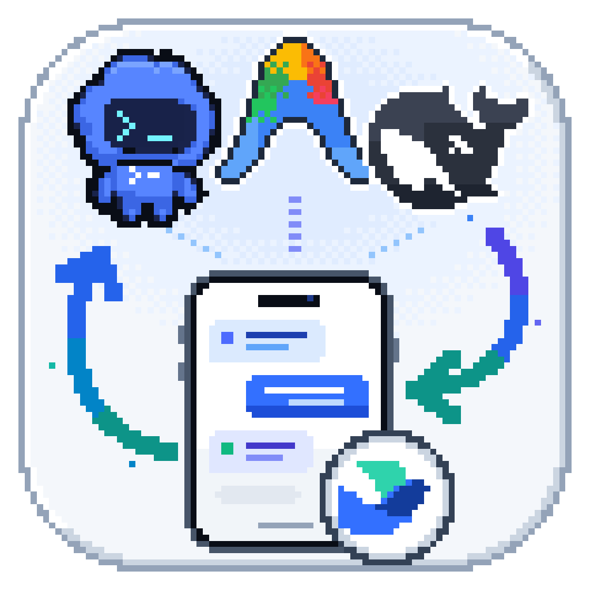
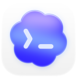
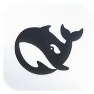

<div align="center">

<picture>
  <source media="(prefers-color-scheme: dark)" srcset="assets/logo.png">
  
</picture>

# NotifyHub

把桌面 Agent 的任务结果发到飞书，手机上也能继续原会话。

<p>
<a href="https://openai.com/codex/"> Codex</a>
&nbsp;&nbsp;
<a href="https://antigravity.google/"> Antigravity</a>
&nbsp;&nbsp;
<a href="https://github.com/deepseek-ai/deepseek-harness"> DeepSeek Harness</a>
&nbsp;&nbsp;
<a href="https://claude.com/product/claude-code"> Claude Code</a>
&nbsp;&nbsp;
<a href="https://commandcode.ai/"> Command Code</a>
</p>

[安装 Skill](#quick-start) · [配置飞书](references/feishu-setup.md) · [手机续聊](#native-bridge) · [更新](#updates) · [排障](#faq)

</div>

## 从电脑到飞书

- **完成通知**覆盖上方五种 Agent，可选择显示最近提问、回答和会话 ID。Codex 还可以显示剩余额度和 Goal 信息。
- **飞书续聊**支持 Codex、Antigravity 和 DeepSeek Harness。选中桌面会话后直接发消息，回复回到飞书原消息下。
- **本地管理界面**通过页头切换通知渠道、Agent 接入、飞书续聊和版本更新。凭据与会话记录都保存在本机。


<a id="quick-start"></a>
## 快速开始

### 1. 安装 NotifyHub Skill

使用 Python **3.10+**。在同一台电脑上用多个 Agent，可以安装到共享的 Skills 目录。

```bash
git clone https://github.com/oldtommmy/notifyhub.git
cd notifyhub
python3 scripts/notifyhub.py install-skill --host shared
python3 ~/.agents/skills/notifyhub/scripts/notifyhub.py gui
```

也可通过 `--host` 选择 Codex、DeepSeek Harness 或 Claude Code 的专用目录，或用 `--skills-dir` 指定路径。安装命令会显示实际 Skill 路径。把「用 NotifyHub Skill 帮我配置飞书完成通知」发给你的 Agent，即可由它引导。 [SKILL.md](SKILL.md)

在源码目录试用时可直接运行 `python3 scripts/notifyhub.py gui`。终端会打印带本地访问令牌的地址，配置期间保持进程运行。

### 2. 创建飞书机器人

在[飞书开发者后台](https://open.feishu.cn/app)创建企业自建应用、添加机器人能力，再在权限管理中一次导入 **[bot-config.json 完整权限预设](bot-config.json)**，按后台提示发布。 [飞书配置图文教程](references/feishu-setup.md)

回到 GUI 的 **通知渠道 → 飞书应用机器人**。填入 App ID 和 App Secret 后，会自动查找应用所有者的 `open_id`。也可点击 **获取接收人**重试，或填写核实过的 ID。需要更改接收人类型或卡片格式时，展开 **接收类型与消息格式**。勾选启用通知并保存，点击 **测试当前渠道**确认收到通知。暂存凭据时可以保留开关关闭。

群机器人 webhook 和 iMessage 可在同一页切换配置。凭据只需填入本机窗口或本机环境变量。 [配置文件与进阶选项](references/config.md)

### 3. 接入你使用的 Agent

在 **Agent 接入 → 总览**查看各 Agent 的本机安装状态和完成通知开关。点击对应行的 **设置**，按需选择通知内容，再点 **安装接入**。字符上限和触发事件可在 **高级通知设置**中调整。

Codex 安装后在 `/hooks` 中信任 NotifyHub。Antigravity 可在宿主的 Hooks 设置里检查 Stop hook。Claude Code 和 Command Code 安装后重启宿主。

DeepSeek Harness 可通过 Skill 或 DSH Market 接入。在 Skill 的 GUI 选择桌面版或 Web，即可安装随附的适配器。也可以在 DSH Market 搜索 **NotifyHub**，安装同版本的独立插件。安装后重启所选宿主。 [DeepSeek Harness 安装与更新](references/dsh.md#market-plugin)

<a id="native-bridge"></a>
## 用飞书继续桌面会话

<a id="gateway"></a>
### 配置独立网关

1. 使用装有 Feishu SDK 的 Python 打开 GUI。macOS/Linux 可先在独立虚拟环境中准备依赖：

   ```bash
   python3 -m venv ~/.local/share/notifyhub/venv
   ~/.local/share/notifyhub/venv/bin/python -m pip install 'lark-oapi>=1.8,<2'
   ~/.local/share/notifyhub/venv/bin/python ~/.agents/skills/notifyhub/scripts/notifyhub.py gui
   ```

2. 在 **飞书续聊**开启续聊、选择 Codex、Antigravity 或 DeepSeek Harness，并填入经过核实的使用者 `open_id`。保存后，在 macOS 点击 **启动网关**。Linux 可运行：

   ```bash
   ~/.local/share/notifyhub/venv/bin/python ~/.agents/skills/notifyhub/scripts/notifyhub.py \
     --config ~/.config/notifyhub/gateway.json gateway
   ```

3. Codex 用户保持目标会话打开，使用支持 App Server 队列和轮次读取的 CLI。DeepSeek Harness 和 Antigravity 用户在 **凭据与适配器**中点击对应的配置按钮，再重启桌面 App。 [原生续聊与迁移](integrations/dsh-native-bridge/README.md)
4. 到飞书后台的 **事件与回调 → 事件配置**，选择 **使用长连接接收事件**并添加 `im.message.receive_v1`。如果后台要求建立连接，先启动上一步的网关。

网关统一收发飞书消息。使用时保持所选 Agent 的桌面 App 运行，权限审批仍在原 App 中处理。已有 DeepSeek Harness 托管安装可使用对应的 GUI 设置，也可切换到独立网关。 [迁移步骤](integrations/dsh-native-bridge/README.md#migrate-gateway)

### 配置卡片按钮

续聊卡片默认显示操作按钮。在飞书后台的 **事件与回调 → 回调配置**选择 **使用长连接接收回调**，添加 **卡片回传交互** `card.action.trigger`，按后台提示发布。回到 GUI 的 **飞书续聊**确认 **在续聊卡片中显示操作按钮**已勾选。更改开关后保存并重载网关。由 DeepSeek Harness 托管时，保存后重启桌面 App。

发 **帮助**获取新的菜单卡片，再检查按钮。也可以发 **会话**，回复列表里的序号继续。旧卡片需要重新获取。普通完成通知是结果摘要，按钮入口出现在续聊的菜单、会话列表和结果卡片上。 [带截图的按钮配置步骤](references/feishu-setup.md#card-callbacks)

### 飞书命令

- **帮助**、**命令**、**菜单**、`help`、`command`、`/help`、`/command` 打开菜单。
- **会话**或 `/sessions` 列出当前 Agent 的会话。用 **Codex会话**、**Antigravity会话**或 **DSH会话**切换入口。
- 点击 **继续此会话**，或回复序号、发送 `/attach 2` 选中本页第 2 条。用 **上一页**和 **下一页**翻页。
- **状态**或 `/status` 查看当前绑定。选中会话后，直接发送想继续聊的内容。
- 单条续聊提问默认最多 5000 字符。结果卡默认预览 3000 字符。点击 **显示完整回答** 可在卡片内阅读全文，长回答支持翻页。

<a id="google-antigravity实验性"></a>
Antigravity 的飞书输入通过托管 Sidecar 送入桌面会话，桌面可能以 `Message from System` 展示。回复会匹配该轮输入。目标会话至少完成一轮后会出现在列表中。

<a id="updates"></a>
## 更新 NotifyHub

GUI 的 **运行与更新**会检查带完整 Skill 包的正式版本。发现新版时，页头会出现提示。从这里可查看 GitHub 发布说明，也可安装更新。安装会校验 SHA-256，并备份现有 Skill。更新后重新打开 GUI，按正在使用的接入方式重载网关或桌面适配器。

也可以让 Agent「用 NotifyHub Skill 检查更新」，或者直接说「把 NotifyHub 更新到最新版」。 [Skill 更新流程](SKILL.md#update-the-skill)

```bash
python3 ~/.agents/skills/notifyhub/scripts/notifyhub.py update
python3 ~/.agents/skills/notifyhub/scripts/notifyhub.py update --apply
```

通过 Git 使用源码时，将工作区更新到所需版本后重新打开 GUI。通过其他路径运行独立网关的旧安装，可以从新 Skill 的 **飞书续聊**页重载网关，使服务引用当前 Skill。

通过 DSH Market 安装的 `dsh-notifyhub` 在原 DeepSeek Harness profile 中更新。可从新版 GitHub Release 下载 `dsh-notifyhub.tgz` 覆盖安装。 [市场插件更新命令](references/dsh.md#market-plugin)

<a id="faq"></a>
## 常见问题

- **飞书有通知，发消息没回应**
  检查网关、私聊 `open_id` 白名单和接收消息事件。保持目标桌面 App 运行。
- **收到卡片但没按钮**
  向机器人发 **帮助**获取续聊菜单，检查 GUI 的按钮开关是否已生效，并核对独立的 `card.action.trigger` 回调订阅。
- **通知晚到或漏发**
  在 **运行与更新**查看发件箱，或执行 `python3 scripts/notifyhub.py flush --status` 检查单条记录。 [发送与补发排障](references/troubleshooting.md)
- **DeepSeek Harness 找不到 CLI**
  优先检查桌面自带 CLI，其次安装官方 npm CLI。 [CLI 安装说明](references/dsh.md#missing-cli)

## 开发

```bash
sh scripts/selftest.sh
python3 scripts/build_skill.py
python3 scripts/build_dsh_plugin.py
```

发行版包含 Skill 压缩包、SHA-256 校验文件和 `dsh-notifyhub.tgz`。DSH 插件打包需要 Node.js 和 npm。DSH Market 的现有条目从最新 GitHub Release 获取插件。 [变更记录](CHANGELOG.md) · [品牌素材来源](assets/agents/README.md)

作者 **oldtommmy**　·　协作者 **OpenAI Codex、Google Antigravity**　·　[MIT](LICENSE)
