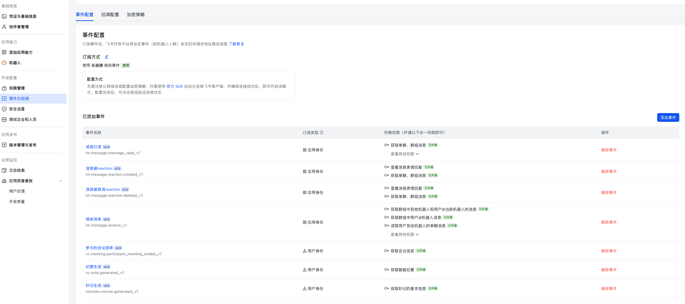
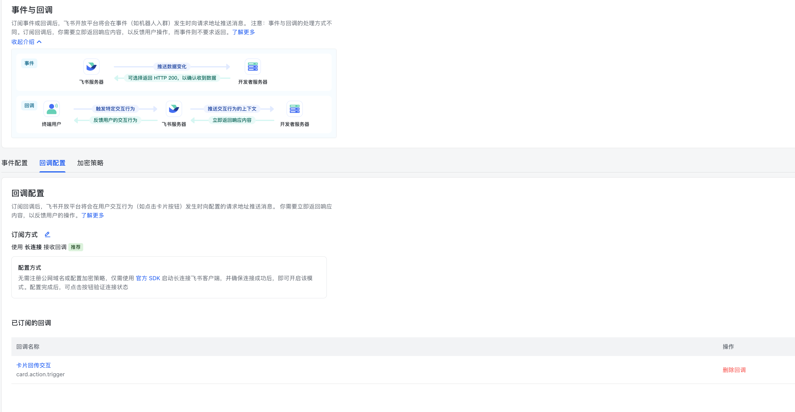

# 飞书机器人配置

[← 返回 README](../README.md)

默认使用 **[bot-config.json 完整权限预设](../bot-config.json)**，在飞书后台一次导入，无需逐项搜索权限。

| 使用方式 | 权限导入 | 导入后还需要 |
|---|---|---|
| 仅接收完成通知 | `bot-config.json` | 开启机器人并发布应用 |
| 完成通知＋手机续聊 | 同一份 `bot-config.json` | 单独配置接收消息事件；用按钮时增加卡片回调 |

## 0. 先打开 notifyhub GUI

在仓库根目录运行：

```bash
python3 scripts/notifyhub.py gui
```

保持终端运行，在打开的页面里准备填写凭据。如果浏览器未自动打开，访问命令打印的完整地址。随后按下面步骤创建飞书应用，再回到 GUI 保存配置和发送测试卡片。

**GUI 与长连接是两件事**：GUI 是本地通知配置界面；dsh 原生插件启动后才会建立续聊使用的飞书长连接。后台如提示“应用尚未建立长连接”，需要先配置并运行原生插件，反复打开 GUI 不会解决该提示。

## 1. 创建企业自建应用

1. 打开[飞书开发者后台](https://open.feishu.cn/app)，创建企业自建应用。
2. 在应用能力中添加 **机器人**。
3. 在“凭证与基础信息”查看 **App ID** 和 **App Secret**。
4. 将 App Secret 填入 notifyhub 的本地 GUI 或环境变量；不要提交到 Git 或贴到聊天里。

notifyhub 使用应用的 `tenant_access_token`，当前通知和续聊流程不需要用户 OAuth 授权。

## 2. 导入权限

进入应用的 **权限管理 → 批量导入/导出权限 → 导入**，复制 **[bot-config.json](../bot-config.json)** 的完整内容，检查应用身份权限清单，再申请开通。

飞书会校验权限是否存在、是否适用于该应用；需要审核或配置数据范围的权限，按后台提示完成。官方步骤见[批量导入导出 API 权限](https://open.feishu.cn/document/server-docs/application-scope/introduction)。

### 本项目的权限范围

| 应用身份权限 | 用途 | 何时需要 |
|---|---|---|
| `im:message:send_as_bot` | 以应用机器人身份发送通知和回复 | 两条路线都需要 |
| `im:message.p2p_msg:readonly` | 读取用户发给机器人的单聊消息 | 手机续聊 |
| `application:application:self_manage` | 应用自身信息访问；用于自动查找接收人的可选配置 | 使用自动获取接收人时按接口和后台要求申请 |
| `im:chat:read` | 读取机器人所在的群列表，作为接收人发现的可选回退 | 需要群列表发现时 |

### 完整预设与可选精简清单

`bot-config.json` 包含 35 项应用身份权限、221 项用户身份权限，覆盖通知、续聊及文档等更多能力。默认安装流程直接使用这份完整预设。当前 notifyhub 收发消息使用应用身份，导入用户权限本身不会启动用户 OAuth 授权。

需要自行控制授权范围时，可以改用[仅通知](../assets/feishu-notify-scopes.json)或[通知＋续聊](../assets/feishu-native-scopes.json)的精简清单，再按需补充应用信息和群列表发现权限。导入精简清单不会自动撤销已有权限。

> **权限、事件、回调是三个独立配置。** 导入 JSON 后，续聊还需要下面的消息事件；卡片按钮还需要卡片回调。

## 3. 发布并让自己的账号可用

确认机器人能力已开启，按后台要求配置应用可用范围、创建版本并发布。需要企业管理员审核时，等待审核通过。

在飞书中找到该机器人并打开私聊。只接收完成通知的用户，到这里即可继续配置 notifyhub，不需要订阅消息事件或卡片回调。

<a id="receiver"></a>
## 4. 配置接收人并测试通知

```bash
python3 scripts/notifyhub.py gui
```

新配置默认使用 `open_id`。接收人为空时，填完 App ID 和 App Secret，GUI 会自动查找应用所有者；已有接收人会保留。可点击“自动获取”重试。获取失败时，检查应用信息权限，或手动填写核实过的接收人。使用其他接收人类型时，先在下拉菜单选择对应类型。

| 接收人类型 | 示例格式 | 发送目标 |
|---|---|---|
| `open_id` | `ou_…` | 当前应用下的某个用户，个人通知优先使用 |
| `chat_id` | `oc_…` | 机器人所在聊天，常用于群聊 |
| `email` | 租户用户邮箱 | 对应飞书租户用户，需能被应用解析 |

`open_id` 与应用有关，不能随意复用其他应用下的值。不要把 `ou_…` 配成 `chat_id`。获取失败时先核对 ID 来源，不要猜测。

保存后发测试卡片，也可以在命令行执行：

```bash
python3 scripts/notifyhub.py test --channel feishu_app
python3 scripts/notifyhub.py doctor
```

确认成功后，回到 [README](../README.md#quick-start) 安装对应 agent 的通知 hook 或插件。

<a id="message-events"></a>
## 5. 续聊：订阅单聊消息

这部分用于 dsh 原生续聊插件（实验性，随 `main` 提供）。配置长连接前，先按[原生插件说明](../integrations/dsh-native-bridge/README.md#installation)准备本地运行环境。飞书后台如提示需要先建立连接，启动 dsh 中已配置的原生插件后再保存。

在应用后台的 **事件与回调 → 事件配置**：

1. 订阅方式选择 **使用长连接接收事件**。
2. 添加 **接收消息**：`im.message.receive_v1`。
3. 确认应用身份权限 `im:message.p2p_msg:readonly` 已开通。
4. 保存，并按后台提示完成发布或审核。

<details>
<summary>查看「事件配置」截图</summary>



截图来自已有应用，包含多种额外订阅。这里只需添加 **接收消息 `im.message.receive_v1`**；消息已读、表情回应、会议和纪要事件不属于当前续聊的必需项。

</details>

长连接由本机主动连接飞书。机器需要联网；原生续聊还要求 dsh App 持续运行、Mac 保持唤醒。

<a id="card-callbacks"></a>
## 6. 按钮：配置卡片回调

在 **事件与回调 → 回调配置** 中单独设置：

1. 订阅方式选择 **使用长连接接收回调**。
2. 添加 **卡片回传交互**：`card.action.trigger`。
3. 保存，并按后台提示完成发布或审核。
4. 在原生续聊使用的独立配置中设置 `bridge.card_actions=true`，重启 dsh 加载配置。

注意选择新版 `card.action.trigger`，而非旧版 `card.action.trigger_v1`。官方说明见[接收并处理回调](https://open.feishu.cn/document/event-subscription-guide/callback-subscription/receive-and-handle-callbacks)。

<details>
<summary>查看「回调配置」截图</summary>



与「事件配置」分别设置。确认本标签页下已出现 **卡片回传交互 `card.action.trigger`**，只在事件标签页添加“接收消息”不会启用按钮。

</details>

原生插件的按钮默认关闭，未订阅回调时继续使用回复序号选择会话。启用后可点击“继续此会话”“刷新列表”“当前会话”；结果卡片还能“切回此会话”。

## 7. 检查整条链路

按顺序验证，便于定位问题：

- **通知**：发送测试卡片 → 飞书私聊收到卡片。
- **接收消息**：在飞书发“会话” → 收到会话列表。
- **按钮**：点“继续此会话” → 收到带会话名的切换成功卡片。
- **续聊**：发送一条简单问题 → 飞书收到回答，桌面原会话也出现本轮消息。

| 问题 | 常见检查项 |
|---|---|
| `99991672` / 缺少权限 | 实际调用接口所需的应用身份权限是否已生效 |
| `230001` / 接收人无效 | ID 类型、值及其所属应用是否匹配 |
| 能发通知，不能收消息 | 消息读取权限、消息事件订阅、原生插件及允许列表 |
| 点击按钮超时或无响应 | 卡片回调是否单独添加，订阅方式是否为长连接 |
| 旧按钮提示失效 | 发“会话”获取新卡片；按钮在 15 分钟后或进程重启后失效 |

日志及其他排障见 [troubleshooting.md](troubleshooting.md)。
